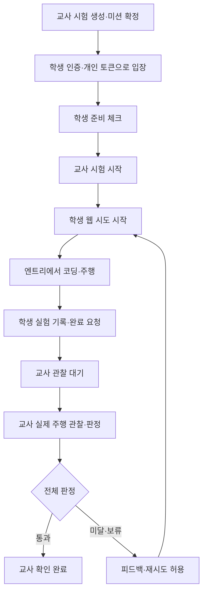
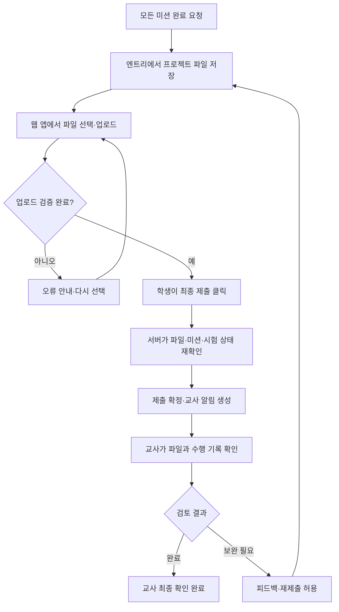

# 햄스터봇 주행 수행평가 웹 앱 설계

## 1. 목적과 설계 범위

학생은 엔트리로 햄스터봇을 코딩하고, 이 웹 앱에서 오늘의 미션·블록 안내·진행 기록을 확인한다. 교사는 한 반의 진행 상황을 확인하고 최종 주행을 관찰한 뒤 판정을 확정한다.

이 문서는 첫 버전의 구현 기준이다. Firebase 프로젝트는 `hamster-ea443`, 데이터베이스는 Cloud Firestore를 선택한다. Firebase Authentication과 서버 작업용 Cloud Functions를 사용한다. 실제 리소스 생성·배포·연결은 아직 하지 않았다. 프런트엔드 프레임워크는 구현 시 정한다. Analytics는 첫 버전에서 사용하지 않는다.

### 확인 범위

- 웹 앱의 ‘시험 시작’은 기록 세션을 시작한다. 엔트리 실행이나 로봇 출발을 원격으로 제어하지 않는다.
- 엔트리 센서·모터 데이터 연동은 검증되지 않았다. 첫 버전에서 자동 주행 검증, 자동 채점, 실제 로봇 연결 상태 표시를 제공하지 않는다.
- 학생 완료 요청과 교사 판정을 각각 기록한다. 학생의 자기 점검을 공식 통과로 표시하지 않는다.
- 코스 촬영·영상 제출·영상 저장은 요구하지 않는다. 손동작 미션에서 엔트리가 카메라를 쓰더라도 이 앱은 영상을 수집하지 않는다.
- 정확한 로봇 모델, 엔트리 버전, 손동작 인식 기능과 블록은 장비 확인 후 확정한다. 아래 로봇 코드는 실제 엔트리 블록명이 아닌 의사코드다.

## 2. 사용자와 운영

| 사용자 | 기능 |
|---|---|
| 교사 | 반·명단 관리, 미션 편집, 시험 생성·시작·일시정지·종료, 진행 확인, 최종 관찰 판정, 재시도 허용 |
| 학생 | 시험 입장, 준비 확인, 미션·힌트 보기, 시도 시작, 실험 기록, 완료 요청, 피드백 확인 |

학생은 Firebase 익명 인증 후 입장 코드와 개인 입장 토큰으로 등록된 명단에 연결한다. 공통 입장 코드만으로 타인 이름을 선택할 수 없게 한다. 교사가 학생에게 개인 토큰을 전달하며 앱에는 토큰 원문을 저장하지 않는다. 토큰 재발급·기기 변경은 교사가 승인하고 기존 UID 접근을 해제한다. 교사는 Google 로그인 등 승인된 계정을 쓰며, 교사 권한은 운영자가 서버에서 부여한다. 학교 계정 정책은 운영 전에 확인한다.

교실에서는 모든 학생이 동시에 연습하고, 완료 요청한 학생부터 교사가 최종 통합 주행을 확인한다. 첫 버전은 점수 합산 대신 기준별 `통과/미달/판단 보류`를 사용한다. 배점은 추후 교사가 정한다.

## 3. 화면 와이어프레임

박스는 배치 설계이며 색·글꼴 등 시각 디자인은 구현 시 정한다. 모바일에서는 좌우 영역과 표를 세로 카드로 바꾼다. 모든 상태는 글자로도 표시한다.

### A. 학생 입장 및 시험 대기

```text
┌ 햄스터봇 주행 수행평가 ─────────────────┐
│ 시험 입장 코드 [          ]           │
│ 개인 입장 토큰 [          ] [입장]     │
│ 오류: 코드가 만료되었습니다.          │
├──────────────────────────────────────┤
│ 1학년 2반 · 07번 · 오늘의 주행 미션    │
│ 교사가 시험을 시작하기를 기다리는 중  │
│ □ 엔트리에서 로봇 연결을 확인했어요   │
│ □ 정지 방법과 주행 공간을 확인했어요  │
│ [준비 완료]  ← 학생이 직접 확인한 상태 │
└──────────────────────────────────────┘
```

준비 표시는 자기 점검이며 앱이 장비 연결을 검사했다는 뜻이 아니다. 입장 후 서버에 연결된 자신의 번호를 보여 주고 잘못 연결되면 교사에게 요청하도록 한다.

### B. 학생 미션 화면

```text
┌ 오늘의 미션 · 시험 진행 중 ─────────────┐
│ 07번 | 학생 보고 2/5 | 교사 확인 대기   │
│ 웹 연결: 정상 / 저장 상태: 저장 완료   │
├ 미션 목록 ─────┬ 현재 미션 ────────────┤
│ 1. 5초 전진    │ 2. 장애물 앞에서 정지 │
│ 2. 장애물 정지 │ 목표 / 준비물 / 성공 조건│
│ 3. 선 따라가기 │ ① 전진 ② 장애물 놓기 │
│ 4. 보자기 정지 │ ③ 정지 확인          │
│ 5. 통합 주행   │ [힌트] [블록 안내]    │
│                │ [실험 기록 입력]      │
│                │ [시도 시작]           │
│                │ [완료 요청] [중단]    │
├────────────────┴──────────────────────┤
│ 최근 결과: 완료 요청 / 교사 확인 대기  │
│ 교사 피드백: 기준값을 조정해 보세요    │
└──────────────────────────────────────┘
```

학생 화면의 시도 시작도 웹 기록만 시작한다. 로봇은 엔트리에서 별도로 실행한다. 진행률은 학생 보고 기준임을 표시하며 교사 판정과 섞지 않는다. 교사만 해설 코드 공개 시점을 변경한다.

### C. 교사 대시보드

```text
┌ 1학년 2반 · 주행 수행평가 ───────────────┐
│ 상태: 대기 [시험 시작] [일시정지] [종료] │
│ 준비 24/28 | 완료 요청 8 | 관찰 미완료 20│
│ [전체] [완료 요청] [판단 보류] [재시도] │
├ 번호 ┬ 준비 ┬ 학생 보고 ┬ 공식 판정 ─────┤
│ 01   │ 완료 │ 5/5      │ 대기           │
│ 02   │ 완료 │ 3/5      │ 대기           │
│ 03   │ 미확인│ 1/5     │ 판단 보류      │
├────────────────────────────────────────┤
│ 완료 요청 대기열: 01번 → 05번 → 08번   │
│ [학생 상세] [시험 설정]       │
└────────────────────────────────────────┘
```

대기열은 최신 통합 미션 시도의 요청 시각순이다. 앱 접속 시각은 참고 정보이며 주행 여부나 집중도를 뜻하지 않는다. 시험 일시정지·종료 시 ‘엔트리에서도 로봇을 정지하세요’를 표시한다. 웹 버튼이 로봇을 정지시키지는 않는다.

### D. 교사 관찰·판정 및 시험 설정

```text
┌ 01번 · 통합 주행 · 시도 2 ──────────────┐
│ 학생 기록 / 이전 시도 / 교사 판정 이력         │
│ 기준                통과 미달 보류      │
│ 선 따라 주행         ○    ○    ○        │
│ 장애물 앞 정지       ○    ○    ○        │
│ 보자기 인식 후 정지  ○    ○    ○        │
│ 정지 후 재시작 절차  ○    ○    ○        │
│ 피드백 [                            ] │
│ [판정 저장] [재시도 허용]              │
│ 판정 수정 시 사유 입력 / 변경 이력 보기│
├ 시험 설정 ────────────────────────────┤
│ 반 / 제목 / 미션 순서 / 힌트 공개 범위  │
│ 재시도 허용 정책    │
│ 완료 조건 / 종료 예정 시각 / 보관 기간 │
│ [임시 저장] [입장 열기]               │
└──────────────────────────────────────┘
```

시험 시작 후 미션 내용과 기준은 고정한다. 변경이 필요하면 새 시험을 만든다. 종료 예정 시각은 안내이며 실제 제출 허용 여부는 서버의 시험 상태로 결정한다. 종료 후에도 교사는 기존 요청을 판정하고 이유를 남겨 수정할 수 있다.

## 4. 미션 구성과 로봇 의사코드

공통 안내: 안전한 공간, 실제 장비에 맞는 낮은 초기 속도, 엔트리에서의 즉시 정지 방법을 먼저 확인한다. 웹 앱을 정지 장치로 사용하지 않는다. 장애물·보자기 정지 후에는 명시적인 다시 시작 조작이 있어야 출발하도록 한다.

| ID | 미션 | 학생 실험 기록 | 관찰 기준 |
|---|---|---|---|
| forward | 5초 전진 후 정지 | 설정 시간, 실제 관찰, 수정점 | 전진 후 정지하며 임의로 재출발하지 않음 |
| obstacle | 장애물 앞 정지 | 근접 센서 관찰값, 선택한 기준값, 결과 | 주행 중 장애물 제시 → 충돌 전 정지 |
| line | 검은 선 따라가기 | 선/바닥 센서 값, 기준값, 속도, 결과 | 교사가 지정한 코스와 이탈 허용 기준 충족 |
| gesture | 보자기 인식 후 정지 | 인식 결과, 인식 기준, 조명 등 조건 | 주행 중 보자기를 제시하면 정지 |
| integrated | 선 따라가기 + 두 정지 조건 | 통합 결과, 실패 원인, 수정점 | 선 주행 및 장애물·보자기 각각의 정지 동작 확인 |

5초는 기본 전진 미션의 목표 시간이다. 실제 속도, 센서 임계값, 반응 허용 시간, 코스 조건은 교사가 장비 검증 후 입력한다. 손동작 기능을 확인하지 못하면 해당 미션을 공식 시험에 포함하지 않는다. 손동작 미션의 카메라 사용·권한은 엔트리 환경에서 처리한다.

```text
미션 1:
  시작 조작을 받으면 낮은 속도로 전진
  5초가 지나면 양쪽 모터 정지

미션 2:
  시작 조작을 받으면 전진
  반복:
    장애물 감지 조건을 만족하면 모터 정지 후 반복 종료

미션 3:
  시작 조작을 받으면 반복:
    좌우 바닥 센서 값을 읽음
    장비와 센서 배치에 맞는 선 추종 규칙으로 방향 조절
    정지 조작 또는 선 분실 안전 조건이면 모터 정지 후 반복 종료

미션 4:
  손동작 인식을 준비하고 시작 조작을 받으면 전진
  반복:
    보자기 인식 조건을 만족하면 모터 정지 후 반복 종료
    인식 오류 등 안전 조건이면 모터 정지 후 반복 종료

통합 미션:
  상태 = 정지
  명시적인 시작 조작과 준비 확인이 있으면 상태 = 주행
  반복:
    수동 정지 또는 장비 오류이면 상태 = 정지
    그렇지 않고 장애물 또는 보자기 감지이면 상태 = 정지
    그렇지 않고 선 분실 안전 조건이면 상태 = 정지
    상태가 정지이면 모터 정지
    상태가 주행이면 선 추종 규칙으로 방향 조절
  감지 조건이 사라져도 자동 재출발하지 않음
```

위 코드는 설계용이며 엔트리에서 동시에 실행되는 스크립트 간 모터 명령 충돌을 방지하는 블록 구성은 실제 장비 실습으로 검증한다.

## 5. 핵심 진행 로직

### 시험과 시도의 상태

- 시험: `draft → lobby → running ↔ paused → ended`. 종료 후 재개하지 않는다.
- 시도: `in_progress → submitted → reviewed`. 학생 중단 시 `abandoned`.
- 판정: 기준별 `pass / not_yet / inconclusive`. 전체 결과는 하나라도 보류면 `inconclusive`, 그 외 하나라도 미달이면 `not_yet`, 필수 기준이 모두 통과면 `pass`. 전체 판정은 `required: true`인 기준만 집계하며 시험마다 필수 기준이 하나 이상 있어야 한다. 선택 기준도 관찰 결과는 저장한다.
- 재시도는 기존 기록을 덮어쓰지 않고 새 시도를 만든다. 이전 판정도 유지한다.



### 서버 명령 의사코드

모든 쓰기는 인증된 Callable Function을 거친다. 클라이언트가 보낸 역할, 시각, 판정 결과를 그대로 신뢰하지 않는다. `requestId`로 중복 클릭·응답 유실 시 중복 생성을 막는다.

```text
명령 실행(requestId, actorUid, payload):
  인증 확인 → 역할·시험 소속·필드 형식·길이 검증
  트랜잭션:
    동일 actorUid/requestId 처리 기록이 있으면 기존 결과 반환
    현재 시험·학생·시도 상태를 읽어 허용된 전이인지 검증
    변경, 이벤트, 처리 결과를 함께 저장(서버 시각 사용)
  커밋 성공 후 화면에 저장 완료 표시

시험 시작(교사):
  소유 교사인지 확인
  lobby 상태와 확정 미션·완료 기준 검증
  running 및 startedAt 저장
  준비 미완료 학생 수는 경고하고 교사가 확인 후 시작 가능

시도 시작(학생, missionId):
  running, 활성 등록, 준비 완료, 시험에 포함된 미션인지 확인
  동일 미션의 진행 중 시도가 있으면 그 시도를 반환
  이전 시도가 있으면 재시도 허가 여부 확인
  학생별 미션 진행 문서의 번호를 증가시키고 새 시도 생성
  첫 버전은 앞 미션의 교사 판정 없이도 다음 미션 연습 가능

완료 요청(학생, attemptId, 관찰 내용):
  자신의 in_progress 시도이며 시험이 running인지 확인
  필수 자기 점검과 실험 기록 검증
  submitted, submittedAt 저장 및 대시보드 요약 갱신
  자동 통과 판정을 만들지 않음

판정 저장(교사, attemptId, expectedRevision, 기준별 결과):
  소유 교사인지, submitted 또는 reviewed 시도인지 확인
  기준 ID가 시험에 고정된 기준과 일치하는지 확인
  현재 revision이 expectedRevision과 다르면 충돌 안내
  서버에서 전체 결과 계산
  판정 및 수정 사유·이전/이후 결과 이벤트 저장
  시도를 reviewed로 변경; 다음 재시도 허용 여부는 별도로 저장

일시정지/종료(교사):
  시험 상태 변경; 클라이언트는 새 학생 명령을 차단
  화면에 엔트리에서도 로봇을 정지하라는 안내
  진행 중 기록을 삭제하거나 실패 처리하지 않음
  종료 시 미제출 시도는 '종료 시 미제출'로 표시
```

일시정지 중에는 서버가 학생 쓰기를 거부한다. 입력 중 메모는 현재 탭에 임시 유지하고 저장되지 않았음을 표시한다. 재개하면 다시 제출하며, 종료된 경우 교사에게 문의하도록 한다. 지속 오프라인 쓰기 큐는 첫 버전에 넣지 않는다. 응답 유실 시 동일 requestId로 재조회·재요청한다. 웹 연결 끊김을 로봇 오류나 수행 실패로 판정하지 않는다.

## 6. Firebase 데이터 구조

### 공통 규칙

- 별도 언급이 없으면 필수 필드다. `?`는 선택, `null`은 아직 발생하지 않은 상태다.
- 시간은 Firestore `Timestamp`와 서버 시각을 사용한다. 화면은 기본 `Asia/Seoul`로 표시한다.
- 모든 문서 ID는 자동 ID 또는 서버가 정한 고유 ID다. 학생 실명 대신 반 내 번호·표시 이름을 최소 저장한다.
- enum은 아래 값만 허용한다. 텍스트·배열 크기는 서버에서 제한한다(메모 최대 2,000자, 미션당 기준 최대 20개).

### 인증·반

| 문서 경로 | 필드: 타입 | 용도 |
|---|---|---|
| `users/{uid}` | `role: 'teacher'|'student'`, `displayName: string`, `createdAt: Timestamp`, `disabled: boolean` | 서버 생성. 교사 역할은 운영자만 부여 |
| `classes/{classId}` | `ownerTeacherUid: string`, `name: string`, `schoolYear: number`, `createdAt: Timestamp`, `archived: boolean` | 반과 소유 교사 |
| `classes/{classId}/students/{studentId}` | `studentNumber: string`, `displayName: string`, `authUid: string|null`, `active: boolean`, `createdAt: Timestamp` | 명단. 번호는 반 내 고유, UID 바인딩은 서버만 변경 |
| `enrollmentSecrets/{tokenHash}` | `classId: string`, `studentId: string`, `expiresAt: Timestamp`, `usedAt: Timestamp|null` | 개인 입장 토큰의 서버 전용 해시. 일회 사용, 원문 저장 금지 |
| `joinCodes/{codeHash}` | `sessionId: string`, `expiresAt: Timestamp`, `active: boolean` | 공통 시험 입장 코드 조회용 서버 전용 해시 |

토큰은 추측하기 어려운 난수로 생성하고 서버 비밀값을 사용한 HMAC으로 조회한다. 입장 함수는 요청 횟수 제한과 App Check를 적용한다. 익명 인증은 학생 신원 확인을 대신하지 않으므로 개인 토큰 배포와 계정 복구는 교사가 관리한다.

### 미션 원본과 시험

| 문서 경로 | 필드: 타입 | 용도 |
|---|---|---|
| `missionTemplates/{templateId}` | `ownerTeacherUid: string`, `title: string`, `kind: 'forward'|'obstacle'|'line'|'gesture'|'integrated'`, `version: number`, `goal: string`, `materials: string[]`, `steps: string[]`, `safetyNotes: string[]`, `criteria: Criterion[]`, `parameters: map`, `recordPrompts: Prompt[]`, `selfCheckDefinitions: Criterion[]`, `updatedAt: Timestamp` | 교사가 편집하는 원본. 학생은 직접 조회하지 않음 |
| `sessions/{sessionId}` | `classId: string`, `ownerTeacherUid: string`, `title: string`, `status: 'draft'|'lobby'|'running'|'paused'|'ended'`, `timezone: string`, `retryPolicy: 'teacher_approval'`, `createdAt: Timestamp`, `startedAt: Timestamp|null`, `endedAt: Timestamp|null`, `scheduledEndAt: Timestamp|null`, `retentionDays: number`, `deleteAfter: Timestamp|null` | 시험 전체 상태. 종료 시 보관 정책에 따라 deleteAfter 계산 |
| `sessions/{sessionId}/missions/{missionId}` | 미션 원본의 콘텐츠 필드 + `sourceTemplateId: string`, `sourceVersion: number`, `order: number`, `guidanceLevel: 'instructions'|'hint'|'skeleton'|'solution'` | 시험용 콘텐츠 스냅샷. 시작 후 본문 변경 금지, 공개 수준만 변경 가능 |
| `sessions/{sessionId}/missions/{missionId}/guidance/{level}` | `format: 'text'|'image'`, `text: string|null`, `imagePath: string|null`, `altText: string`, `updatedAt: Timestamp` | level은 hint/skeleton/solution. 공개 수준에 맞는 문서만 읽기 허용 |

`Criterion = { id: string, label: string, required: boolean }`.
`Prompt = { id: string, label: string, required: boolean }`.
`selfCheckDefinitions`는 학생 완료 요청에 쓰는 항목이며 교사 판정 기준인 `criteria`와 별개다. `selfChecks`와 `recordAnswers`의 키는 각각 이 정의의 ID만 허용한다.
`parameters`는 검증된 미션별 값만 포함한다. 예: `{ durationSeconds: 5, speedSetting: null, sensorThreshold: null, reactionLimitMs: null, courseDescription: '' }`. 미확정 값은 null이며 판정 기준으로 사용하지 않는다. 공식 시험에 필요한 기준값은 입장 전 교사가 확정한다. 해설은 숨긴 화면 안에 미리 내려받지 않으며 이미지도 같은 접근 권한을 적용한다.

### 학생 진행·시도·판정

아래 경로는 모두 `sessions/{sessionId}/` 아래다.

| 상대 경로 | 필드: 타입 | 용도 |
|---|---|---|
| `participants/{studentId}` | `studentId: string`, `authUid: string`, `studentNumber: string`, `displayName: string`, `readyChecks: { entryConnection: boolean, stopMethod: boolean, safeSpace: boolean }`, `readyAt: Timestamp|null`, `joinedAt: Timestamp`, `lastSeenAt: Timestamp`, `reportedMissionCount: number`, `teacherPassedMissionCount: number`, `latestSubmissionAt: Timestamp|null` | 본인·교사만 읽는 진행 요약. 집계 필드는 서버만 계산 |
| `participants/{studentId}/progress/{missionId}` | `latestAttemptId: string|null`, `nextAttemptNumber: number`, `reportedComplete: boolean`, `latestTeacherResult: 'unreviewed'|'pass'|'not_yet'|'inconclusive'`, `retryAllowed: boolean`, `updatedAt: Timestamp` | 동일 미션 중복 시작 방지와 재시도 관리. 최신 시도 기준으로 집계 |
| `attempts/{attemptId}` | `studentId: string`, `studentUid: string`, `missionId: string`, `attemptNumber: number`, `status: 'in_progress'|'submitted'|'reviewed'|'abandoned'`, `startedAt: Timestamp`, `submittedAt: Timestamp|null`, `selfChecks: map<string,boolean>`, `recordAnswers: map<string,string>`, `studentNote: string`, `updatedAt: Timestamp` | 실제 센서 로그가 아닌 학생이 입력한 시도 기록 |
| `evaluations/{attemptId}` | `studentId: string`, `missionId: string`, `teacherUid: string`, `criteriaResults: map<string,'pass'|'not_yet'|'inconclusive'>`, `overall: 'pass'|'not_yet'|'inconclusive'`, `feedback: string`, `revision: number`, `createdAt: Timestamp`, `updatedAt: Timestamp` | 교사의 공식 판정. 수정 사유는 이벤트에 필수 저장 |
| `events/{eventId}` | `actorUid: string`, `actorRole: 'teacher'|'student'|'system'`, `type: string`, `studentId: string|null`, `attemptId: string|null`, `at: Timestamp`, `payload: map` | 추가만 가능한 이력. 시작·제출·판정·상태 변경 등을 서버 기록 |
| `commandReceipts/{uid_requestId}` | `actorUid: string`, `command: string`, `resultIds: map`, `createdAt: Timestamp`, `deleteAfter: Timestamp` | 서버 전용 중복 실행 방지. 최초 처리 후 7일 보관 |

이벤트 type은 `session_started / session_paused / session_resumed / session_ended / attempt_started / attempt_abandoned / attempt_submitted / evaluation_saved / retry_granted / guidance_changed`로 제한한다. 판정 변경 payload는 `before`, `after`, `reason`, `revision`을 포함한다. 다른 이벤트는 필요한 식별자와 변경 필드만 저장한다. 토큰과 자격 증명을 기록하지 않는다.

재시도 시작 시 최신 시도 기준 학생 보고·교사 통과 집계를 재계산한다. 과거 통과는 이력에서 확인할 수 있지만 최신 결과처럼 표시하지 않는다. 참가자 등록과 각 요약 갱신은 원본 기록과 같은 서버 트랜잭션에서 처리한다.

### 예시 시도 문서

```json
{
  "studentId": "student07",
  "studentUid": "firebase-auth-uid",
  "missionId": "obstacle",
  "attemptNumber": 1,
  "status": "submitted",
  "startedAt": "<Firestore Timestamp>",
  "submittedAt": "<Firestore Timestamp>",
  "selfChecks": { "wasMoving": true, "stoppedForObstacle": true },
  "recordAnswers": { "threshold": "실험에서 선택한 값", "result": "장애물 앞에서 멈춤" },
  "studentNote": "처음에는 너무 가까이에서 멈춰 기준을 조정했다.",
  "updatedAt": "<Firestore Timestamp>"
}
```

JSON의 시간 문자열은 설명용이다. 실제 저장 시 Timestamp를 사용한다. 위 학생 보고만으로 통과 판정을 생성하지 않는다.

## 7. 접근 권한과 서버 책임

클라이언트의 Firestore 직접 쓰기는 모두 거부한다. Functions Admin SDK는 Security Rules를 우회하므로 각 함수에서 역할·소유권·현재 명단 바인딩·시험 상태·허용 필드를 다시 검사한다. 클라이언트가 제공한 UID로 권한을 결정하지 않는다.

| 데이터 | 교사 | 학생 본인 |
|---|---|---|
| 자기 반·명단 | 소유 반 읽기, 함수로 관리 | 본인 명단 문서만 읽기 |
| 시험·공개 미션 | 소유 시험 읽기·함수로 관리 | 활성 등록 시험만 읽기 |
| 참가자·시도·교사 판정 | 소유 시험 전체 읽기 | 본인 것만 읽기 |
| events | 소유 교사 읽기 | 직접 읽기 불가 |
| 토큰·입장 코드·명령 영수증 | 클라이언트 직접 접근 불가 | 접근 불가 |

학생 쿼리는 studentId 또는 authUid 등 소유권 필터를 포함한다. Firestore Rules는 필터 역할을 하지 않으므로 전체 목록 요청을 금지하고 허용 범위의 쿼리만 실행한다. UID가 바뀐 경우 오래된 문서에 남은 UID만으로 접근을 허용하지 않고 현재 활성 명단 바인딩도 확인한다.

선택적 블록 안내 이미지에는 Cloud Storage를 사용하고 해설 공개 수준과 시험 소속을 검사하는 규칙을 적용한다. 비공개 이미지는 영구 공개 다운로드 URL로 배포하지 않는다. 서비스 계정 비밀 키는 프런트엔드에 포함하지 않는다.

## 8. 조회·실시간 갱신·보관

- 교사 대시보드는 해당 시험의 participants만 실시간 구독한다. 요청 대기열은 요약을 기준으로 정렬한다.
- 학생은 시험 상태, 공개 미션, 본인 진행 요약만 구독한다. 상세 시도·평가는 화면 진입 시 제한 조회한다.
- 필요한 복합 인덱스: attempts `(studentId, missionId, attemptNumber DESC)`, events `(attemptId, at DESC)` 및 화면 구현에서 실제 사용하는 쿼리의 인덱스.
- 화면을 벗어나거나 로그아웃하면 구독을 해제한다. lastSeenAt은 화면 활성 중 최대 60초에 한 번 갱신하고 실제 로봇 연결 상태로 표현하지 않는다.
- Functions는 예정된 정리 작업으로 deleteAfter가 지난 시험의 하위 컬렉션·이미지·코드·영수증까지 삭제한다. Firestore 부모 문서 삭제만으로 하위 데이터가 삭제되지 않음을 고려한다.
- 보관 기간은 교사가 학교 정책에 맞춰 시험 생성 시 정한다. 실제 운영 전 복구·삭제 절차와 Firebase 과금·리전·Functions 배포 조건을 확인한다.

## 9. 구현 완료 확인 기준

1. 두 학생으로 입장해 서로의 기록을 읽거나 수정할 수 없는지 에뮬레이터에서 확인한다.
2. 공통 코드만으로 타인을 사칭할 수 없고 만료·사용한 개인 토큰을 재사용할 수 없는지 확인한다.
3. 시험 대기·일시정지·종료 중 학생 쓰기를 서버가 거부하며 로봇 정지 안내를 표시하는지 확인한다.
4. 중복 클릭·응답 유실에도 같은 requestId가 시도·판정을 중복 생성하지 않는지 확인한다.
5. 학생 완료 요청만으로 공식 통과가 되지 않는지 확인한다.
6. 교사 판정 수정 충돌을 감지하고 이전 결과·수정 사유를 보존하는지 확인한다.
7. 재시도가 과거 이력을 보존하면서 최신 진행 요약을 올바르게 갱신하는지 확인한다.
8. 미공개 해설 문서·이미지를 학생이 직접 요청해도 읽을 수 없는지 확인한다.
9. 연결 끊김과 저장 실패를 성공으로 표시하지 않고, 재접속 후 서버 상태를 다시 읽는지 확인한다.
10. 한 반 규모의 모의 데이터로 대시보드·대기열·학생 상세를 확인하고 모바일·키보드 조작도 검증한다.
11. 실제 엔트리와 로봇으로 각 미션을 검증하고, 웹 시험 종료가 로봇을 정지시키지 않는다는 안내를 확인한다.
12. 보관 만료 시 하위 문서와 안내 이미지까지 삭제되는지 개발 환경에서 확인한다.

이 설계는 영상이나 검증되지 않은 엔트리 연동 없이 교사의 진행 관리 부담을 줄이는 첫 버전이다. 실제 주행의 최종 판정은 교사의 관찰이며, 향후 데이터 연동이 검증되면 별도 설계로 센서 기록 기능을 확장한다.

## 10. 최종 제출·완료 알림·실시간 진행 설계

이 절은 앞 절의 흐름을 확장한다. 학생은 미션별 완료 요청을 남기고, 모든 미션의 학생 보고가 완료되면 엔트리 파일을 최종 제출한다. 교사는 제출 알림을 통해 파일과 수행 기록을 확인한다. 파일 검토는 실제 주행 관찰을 보완하며 자동 주행 검증을 대신하지 않는다.

### 학생 진행과 교사 확인의 구분

- 미션별 상태: `미시작 / 수행 중 / 완료 요청 / 교사 확인`을 표시한다. 교사 확인에는 통과·미달·판단 보류 결과를 함께 표시한다.
- 학생 보고 진행률: 최신 시도가 submitted 또는 reviewed인 미션 수 / 시험의 전체 미션 수. 시도를 시작하거나 미완료 메모만 저장한 것은 완료에 포함하지 않는다.
- 교사 확인 진행률: 최신 시도에서 교사가 판정한 미션 수 / 전체 미션 수. 교사 통과 수는 별도 표시한다.
- 재시도를 시작하면 해당 미션의 최신 상태는 수행 중이 되고 학생 보고 진행률도 다시 계산한다.
- 실시간 갱신은 앱에서 시작·저장·완료 요청한 상태를 의미한다. 엔트리 내부 작업이나 실제 주행을 자동 감지하지 않는다.
- 모든 미션의 학생 보고가 완료되면 최종 제출을 허용한다. 교사가 모든 미션을 먼저 판정할 필요는 없다.

### 최종 제출 흐름



학생의 완료 연락은 **교사 웹 앱 내부 알림**으로 제공한다. 이메일·문자·외부 메신저는 첫 버전에 포함하지 않는다. 교사가 앱을 닫았다가 다시 열어도 미확인 알림과 제출 대기열을 조회할 수 있다. 소리나 브라우저 알림은 필수가 아니다.

### 학생 최종 제출 화면

```text
┌ 미션 수행 완료 · 학생 보고 5/5 ─────────┐
│ ① 엔트리에서 프로젝트 파일을 저장하세요│
│ ② 제출할 파일을 선택하세요            │
│ [파일 선택] my-project.ent             │
│ 업로드: 완료 / 아직 최종 제출 전       │
│ 마지막 설명 [수정한 점과 어려웠던 점]  │
│ [파일 바꾸기] [선생님께 최종 제출]     │
├──────────────────────────────────────┤
│ 제출 후: 제출 완료 · 선생님 확인 대기  │
│ 제출 시각 / 제출 번호 / 파일 이름      │
│ 교사 피드백과 재제출 버튼(허용 시)     │
└──────────────────────────────────────┘
```

엔트리 프로젝트 다운로드 방법과 실제 확장자는 사용할 엔트리 환경에서 확인한다. `.ent`는 예상 예시이며 운영 전 실제 파일로 검증한다. 브라우저에서 엔트리 계정이나 프로젝트를 자동으로 가져오지 않는다.

### 교사 실시간 대시보드 확장

```text
┌ 오늘의 시험 ──────────────────────────┐
│ 제출 대기 8명 [미확인 알림 3]          │
│ 번호 | 학생 보고 | 교사 판정 | 최종 제출│
│ 01   | 5/5       | 2/5      | 확인 대기│
│ 02   | 3/5       | 1/5      | 미제출   │
│ 03   | 5/5       | 5/5      | 확인 완료│
│ 학생 선택 → 미션별 상태·기록·시도 이력 │
├ 제출 상세 ────────────────────────────┤
│ 01번 · 제출 1 · 서버 접수 시각         │
│ 파일 이름 / 크기 [파일 다운로드]      │
│ 학생 설명 / 미션별 기록 / 교사 판정    │
│ 피드백 [                           ]  │
│ [확인 완료] [보완 요청·재제출 허용]    │
└──────────────────────────────────────┘
```

파일 다운로드나 알림 열람만으로 확인 완료 처리하지 않는다. 교사가 명시적으로 검토 결과를 저장해야 한다. 최종 제출 검토 완료와 실제 주행 기준 통과도 별개로 표시한다. 교사가 파일을 엔트리에서 열어 확인하는 절차를 안내하며 파일 내용을 웹에서 실행하지 않는다.

### Firebase 추가 구조

Storage 경로는 `sessions/{sessionId}/submissions/{studentId}/{submissionId}/project`로 고정한다. 원래 파일 이름은 표시용 메타데이터로만 저장하며 경로에 직접 넣지 않는다.

아래 문서 경로는 `sessions/{sessionId}/` 아래다.

| 경로 | 필드: 타입 | 용도 |
|---|---|---|
| `submissions/{submissionId}` | `studentId: string`, `studentUid: string`, `version: number`, `status: 'uploading'|'ready'|'submitted'|'reviewed'|'rejected'|'expired'`, `storagePath: string`, `originalFileName: string`, `sizeBytes: number|null`, `contentType: string|null`, `storageGeneration: string|null`, `sha256: string|null`, `studentNote: string`, `attemptIdsByMission: map<string,string>`, `createdAt: Timestamp`, `uploadExpiresAt: Timestamp`, `submittedAt: Timestamp|null`, `reviewedAt: Timestamp|null`, `reviewerUid: string|null`, `reviewResult: 'complete'|'needs_revision'|null`, `teacherFeedback: string`, `revision: number` | 제출 버전마다 새 문서를 만들고 제출 당시 미션 시도 ID를 고정 |
| `submissionState/{studentId}` | `latestSubmissionId: string|null`, `nextVersion: number`, `resubmissionAllowed: boolean`, `updatedAt: Timestamp` | 서버 전용 제출 번호·재제출 제어 |
| `teacherNotifications/{notificationId}` | `teacherUid: string`, `studentId: string`, `submissionId: string`, `type: 'final_submitted'`, `createdAt: Timestamp`, `readAt: Timestamp|null` | 제출 ID를 알림 ID로 사용하여 중복 방지. 학생 접근 금지 |

`participants/{studentId}`에 다음 서버 계산 필드를 추가한다.

- `teacherReviewedMissionCount: number`: 최신 시도에 대해 교사가 판정한 미션 수.
- `latestSubmissionId: string|null`, `latestSubmittedAt: Timestamp|null`.
- `submissionStatus: 'not_submitted'|'submitted'|'complete'|'needs_revision'`.

이벤트 type에 `final_submitted / submission_reviewed / resubmission_granted / submission_download_requested / notification_read`를 추가한다. 제출 판정 수정 시 제출 ID·이전/이후 결과·사유·revision을 남긴다. 다운로드 요청 이력은 교사가 파일을 실제로 열거나 읽었다는 증거가 아니다.

### 업로드와 제출 확정 의사코드

```text
제출 준비(학생, requestId, 파일 정보):
  running, 활성 등록, 모든 미션 최신 시도의 완료 요청 여부 확인
  미확정 제출이 있으면 반환; 기존 정식 제출이 있으면 재제출 허가 확인
  트랜잭션으로 다음 제출 번호와 uploading 문서, 30분 업로드 기한 생성
  고정 Storage 경로 반환

업로드:
  Storage Rules에서 본인·현재 등록·시험 running·기한·uploading 상태 확인
  신규 객체 생성만 허용; 학생의 덮어쓰기와 삭제 금지
  Storage 이벤트에서 서버가 크기·확장자·실제 파일 형식 검사
  유효하면 generation·SHA-256·크기를 기록하고 ready, 아니면 rejected

최종 제출(학생, submissionId, requestId):
  ready, running, 본인, 모든 미션 완료 요청 여부 재확인
  현재 미션별 시도 ID를 고정
  트랜잭션으로 submitted·서버 시각·요약·교사 알림·이벤트 저장
  성공한 뒤에만 학생에게 제출 완료 표시

교사 검토(교사, submissionId, expectedRevision, 결과, 피드백):
  소유 교사·제출 상태·revision 일치 확인
  reviewed와 검토 결과 저장; 보완 요청 시 피드백 필수
  재제출 허가는 명시적으로 설정; 과거 제출과 판정 보존
```

모든 명령은 앞 절의 requestId 중복 방지와 권한 검사를 적용한다. 알림 읽음과 다운로드 요청도 인증된 서버 함수로 처리한다. 파일 검토 완료는 미션별 실제 주행 통과를 자동 생성하지 않는다.

### 제한·권한·오류 처리

- 초기 파일 상한은 20 MiB로 제안하며 실제 수업 파일로 확인한다. 초과 시 이유를 표시하고 교사가 설정을 검토한다. 최종 확정 상한은 sessions의 `maxSubmissionBytes: number`로 저장하고 Storage 규칙과 서버에서 동일하게 적용한다.
- 파일 이름과 MIME만으로 안전하다고 판단하지 않는다. 실제 엔트리 파일 규격을 확인해 검증기를 구현한다. 압축 형식이면 해제 용량·항목 수·경로를 제한하고 코드 실행 없이 검사한다.
- 제출한 파일은 수정 불가다. 재제출은 새 문서와 객체를 만들고 과거 버전도 교사가 조회할 수 있게 한다.
- 학생은 본인 제출만, 소유 교사는 해당 시험 제출만 읽는다. Storage 규칙도 현재 명단 바인딩을 확인한다. 공개 다운로드 URL을 저장하지 않고 인증된 다운로드를 사용한다.
- 일시정지·종료 후에는 업로드와 최종 제출을 거부한다. 종료 전 ready 파일도 종료 후 확정할 수 없다. 마감 후 예외는 교사가 별도 시험을 마련하며, 기존 제출의 교사 검토는 종료 후에도 가능하다.
- 정식 제출 후 새 미션 시도는 교사의 재제출 허가가 있어야 시작할 수 있다. 새 시도를 시작하면 현재 제출 요약을 needs_revision으로 표시하고 이전 제출은 이력으로 보존한다.
- 통신 단절·검증 실패를 제출 성공으로 표시하지 않는다. 같은 명령은 같은 requestId로 재시도한다. 업로드 완료와 최종 제출 완료를 구분한다.
- 만료된 uploading/ready 문서와 미제출 객체는 정기 작업으로 정리한다. 시험 보관 만료 시 제출 전 버전과 알림까지 삭제한다. Storage 이벤트 재전송은 같은 generation으로 중복 검증하지 않는다.
- 교사 알림은 앱에서 실시간 구독하고 시험 변경·로그아웃 때 해제한다. 다시 접속하면 서버의 미확인 알림을 읽는다.
- 추가 복합 인덱스: teacherNotifications `(teacherUid, readAt, createdAt DESC)`, submissions `(studentId, version DESC)`. 제출 대기열은 참가자 요약과 latestSubmittedAt으로 구성한다.

### 추가 완료 확인 기준

1. 학생의 시작·완료 요청이 다른 기기의 교사 화면에 반영되고 실제 주행 자동 검증으로 오해하게 표시하지 않는다.
2. 전체 미션 미완료, 타인 파일, 미검증 파일, 덮어쓰기, 크기 초과, 만료 요청을 거부한다.
3. 최종 제출 재전송에도 제출 번호와 교사 알림이 중복 생성되지 않는다.
4. 교사 앱이 꺼져 있을 때 접수된 제출도 재접속 후 미확인 알림과 대기열에 표시된다.
5. 다운로드 요청·알림 읽음·최종 검토 완료를 별도 동작으로 기록한다.
6. 재제출이 과거 파일·시도·판정을 덮어쓰지 않는다.
7. 권한 없는 학생은 Storage 경로를 직접 지정해도 내려받을 수 없다.
8. 실제 엔트리 파일로 저장·제출·다운로드한 뒤 교사의 엔트리 환경에서 열리는지 확인한다.


## 11. 첫 구현의 범위 (브라우저 데모)

현재 구현은 이 설계의 화면과 기본 흐름을 검토하는 데모다. 학생 준비·5개 미션 시작과 완료 요청·실험 기록·엔트리 파일 최종 제출·교사 알림·파일 다운로드·미션 판정·파일 검토·재시도를 제공한다. 역할과 학생은 화면에서 전환하고, 데이터·파일은 IndexedDB에 저장하며 같은 브라우저의 탭 간 변경만 갱신한다.

앞 절의 Firebase 서버·Authentication·Storage 보안 규칙·개인 토큰 입장·자동 파일 검증·판정 revision 충돌 감지·보관 만료 삭제는 아직 구현하지 않았다. 서버가 없으므로 클라이언트 역할 확인은 보안 장치가 아니다. 이 데모를 공식 평가나 실제 개인정보 저장에 사용하지 않는다.

미션 판정은 첫 UI에서 미션별 종합 결과로 입력한다. 기준별 판정 입력, 해설 공개 단계, 시험 설정·명단 관리 UI는 운영 버전에서 확장한다. 현재 앱의 내용은 의사코드이며 엔트리 블록과 로봇 동작 검증은 별도로 필요하다.
